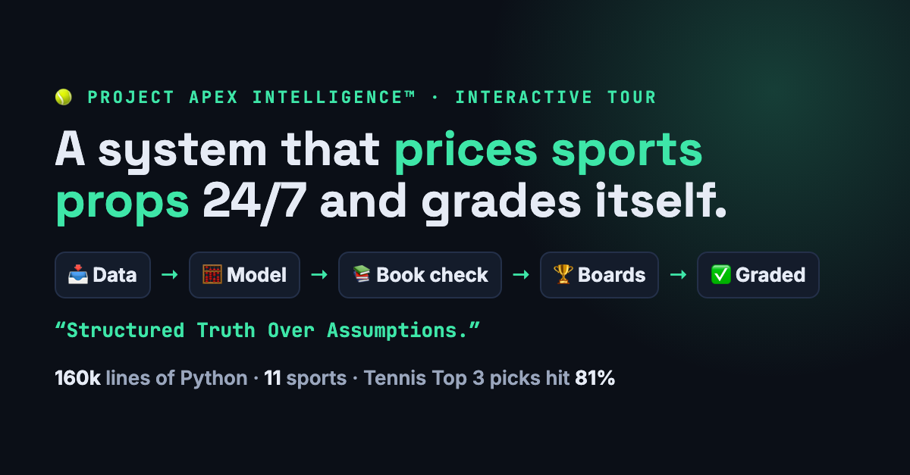

<a href="https://demetriusreynolds251-maker.github.io/apex/"><b>▶ Take the interactive tour</b></a>

# Project Apex Intelligence™: project showcase

> *"Structured Truth Over Assumptions."*

The one-page site for **Project Apex Intelligence™**, my highest-level analysis engine: a sports prop-pricing system: https://demetriusreynolds251-maker.github.io/apex/

It's a single self-contained `docs/index.html` with no build step and no tracking. All example data on the page is made up.

Code: [apex-tennis](https://github.com/demetriusreynolds251-maker/apex-tennis) · [apex-multisport](https://github.com/demetriusreynolds251-maker/apex-multisport) · [apex-tennis-research](https://github.com/demetriusreynolds251-maker/apex-tennis-research) · [apex-tennis-warehouse](https://github.com/demetriusreynolds251-maker/apex-tennis-warehouse)

> Designed and directed by Demetrius Reynolds and built with AI coding assistants. I understand the code and architecture but am not a professional software engineer.

## Let's connect

I'm an operations and business leader in Mobile, Alabama, and I build data tools like this in my spare time. I like meeting new people and helping with projects. **[Connect with me on LinkedIn](https://www.linkedin.com/in/demetrius-reynolds/)**.

## License

[Apex Share-Back License 1.1](LICENSE): free to use, study and build on for non-commercial purposes. If you use it, you agree to share your findings and improvements back publicly and for free and credit "Based on Apex by Demetrius Reynolds". Selling it or using it in a paid product needs a written commercial license: [ask on LinkedIn](https://www.linkedin.com/in/demetrius-reynolds/). See the [terms on the site](https://demetriusreynolds251-maker.github.io/apex/#share).
